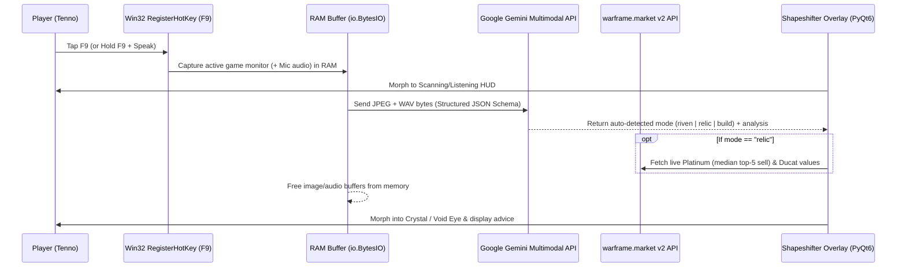

# WF-AI — Warframe AI Overlay Assistant (Shapeshifter Cephalon)

<p align="center">
  <b><a href="#-english-documentation">🇬🇧 English Documentation</a></b> &nbsp;|&nbsp;
  <b><a href="#-türkçe-kullanım-kılavuzu">🇹🇷 Türkçe Kullanım Kılavuzu</a></b>
</p>

---

# 🇬🇧 English Documentation

**WF-AI** is an ultra-lightweight, zero-ban-risk, shape-shifting desktop Cephalon overlay assistant for **Warframe**. With a single hotkey (`F9`), it captures your active game monitor **100% in RAM (zero disk writes)**, automatically detects what screen you are on (**Riven Reroll/Card**, **Void Relic Reward Selection**, or **Arsenal Upgrade/Build**), morphs its visual geometry accordingly, and delivers instant advice powered by **Google Gemini Multimodal AI** and live **warframe.market v2** pricing.

---

## ✨ Key Technical Highlights (Portfolio Overview)

- **🛡️ 100% Safe / Zero Ban Risk (Complete Process Isolation):**
  - Does **not** read or write game memory (`ReadProcessMemory`), inject DLLs, hook DirectX/OpenGL, or simulate inputs/macros.
  - Uses standard Windows Desktop Duplication / GDI screen capture (identical to OBS or Discord screen sharing) and the native OS `RegisterHotKey` API (no low-level `WH_KEYBOARD_LL` hooks).
- **⚡ 100% In-Memory Pipeline (Zero Disk Footprint):**
  - Screenshots (`mss` / `Pillow` $\rightarrow$ `io.BytesIO` JPEG) and push-to-talk voice queries (`sounddevice` $\rightarrow$ `io.BytesIO` WAV) live strictly in RAM and are garbage-collected immediately after the API call. Nothing is ever saved to disk.
- **🚀 Native In-Process `WF-AI.exe` Host:**
  - Compiled via a custom C#/.NET P/Invoke host (`src/build_exe.py`) that dynamically locates `python3XX.dll` from `.venv/pyvenv.cfg` and executes `Py_Main` **in-process**.
  - Runs as a single native process (**`WF-AI` / `WF-AI.exe`**) in Windows Task Manager with its own multi-resolution diamond icon (`assets/wf-ai.ico`)—no separate `python.exe` or `pythonw.exe` child processes.
- **🎨 Shape-Shifting 60 FPS Vector UI & 0% Idle CPU:**
  - Hardware-independent custom `QPainter` vector animations (`PyQt6`) that completely stop their timer in Idle mode (**0.0% CPU / GPU impact on FPS**).
  - **Ghost Click-Through Mode (`WS_EX_TRANSPARENT`):** Mouse clicks pass straight through the overlay into the game during combat. Hold `Alt` to interact, drag, or open the live World State panel.



---

## 🔑 API Requirement (Important for New Users)

> [!IMPORTANT]
> **Which AI API Key is required?**
> This application is built specifically on the **Google Gemini Multimodal API** (`google-genai` SDK) because it natively processes **Image + Audio + Structured JSON Schema** in a single low-latency request.
> - **Supported API:** **Google Gemini API Key** (starts with `AIzaSy...`). OpenAI (`sk-...`) or Anthropic Claude keys are **not** compatible out of the box.
> - **Cost:** **100% Free** via Google AI Studio's Free Tier (no credit card or billing account required).
> - **Built-in Multi-Model Quota Fallback:** WF-AI automatically rotates across `gemini-3.7-flash`, `gemini-3.6-flash`, `gemini-3.5-flash`, `gemini-3.5-flash-lite`, and `gemini-3.1-flash-lite` if a single model's per-minute free quota is reached.

**How to get your free key (takes 15 seconds):**
1. Go to **[Google AI Studio](https://aistudio.google.com/apikey)** and sign in with your Google account.
2. Click **"Create API key"** (Keep *"Default Gemini Project"* selected).
3. Copy the generated key and paste it into WF-AI's prompt on first launch.

---

## 🚀 Installation & Quick Start

1. **Set Warframe to Borderless Fullscreen:** In Warframe settings (`Options -> Video -> Display Mode`), select **Borderless Fullscreen** so Windows allows overlays above the game.
2. **Clone or Download the Repository:**
   ```bash
   git clone https://github.com/erentork/WF-AI.git
   cd WF-AI
   ```
3. **Run `WF-AI.exe` (or `setup_and_run.bat`):**
   - Double-click **`WF-AI.exe`** (or **`setup_and_run.bat`**).
   - On first run, it automatically installs Python 3.12 (via `winget` if missing), creates the `.venv` virtual environment, installs dependencies, builds the native `WF-AI.exe` host, and launches the overlay.
4. **Paste your Gemini API Key** when prompted.

---

## ⌨️ Controls & Hotkeys

| Hotkey / Action | Function | Description |
| :--- | :--- | :--- |
| **`F9` (Tap)** | **🔍 Auto-Detect & Analyze** | Captures your active game screen in RAM, auto-detects **Riven**, **Relic**, or **Build**, morphs the pet, and shows advice. |
| **`F9` (Hold + Speak)** | **🎙️ Push-to-Talk Voice Query** | Listens to your microphone while held (`DİNLİYOR... 🎙`). On release, sends **Screenshot + Voice** together. |
| **`Alt + Left-Drag`** | **✋ Move Overlay** | Hold `Alt` and drag the pet anywhere on any monitor. Position is saved automatically. |
| **`Alt + Left-Click (on Pet)`** | **🌍 Live World State** | Toggles live **Cetus (Day/Night)**, **Vallis**, **Cambion**, **Archon Hunt**, **Sortie**, **Steel Path**, and **Baro Ki'Teer** timers. |
| **`Alt + Right-Click`** | **❌ Dismiss Bubble** | Immediately closes the active speech bubble and returns the pet to Idle mode. |

### 🎨 Shape-Shifting Visual Modes
- **🟢 Green Cyber-HUD Pill (`WF-AI`):** Idle mode (`0% CPU`) & Scanning/Listening wave animation.
- **🟣 Purple Cephalon Crystal (`RIVEN`):** Evaluates Riven stats, weapon synergy (Crit/Status/Incarnon), harmless negatives, Left vs. Right reroll choice, and estimated Platinum range.
- **🟡 Golden Orokin Void Eye (`RELIC`):** Reads all 1–4 Void Fissure rewards from left to right, fetches live **warframe.market** Platinum & Ducat prices, and highlights the best pick (`🏆 SEÇ: ...`).
- **🔵 Blue Cephalon Crystal (`BUILD`):** Analyzes your Warframe/weapon modding screen and suggests missing multipliers, Galvanized/Primed/Bane swaps, and Arcane synergies.

---
---

# 🇹🇷 Türkçe Kullanım Kılavuzu

Warframe oynarken ekrana küçük bir **Cephalon / HUD** olarak yerleşen, oyun dosyalarına veya RAM'ine hiç dokunmayan (**%0 Ban Riski**), ekran görüntüsünü ve sesini diske kaydetmeden (**%100 RAM-içi**) analiz eden yapay zeka asistanı.

---

## 🔑 Hangi Yapay Zeka API Anahtarı Gerekir? (Önemli)

> [!IMPORTANT]
> Bu uygulama hem görüntüyü hem sesli soruları hem de yapılandırılmış JSON çıktısını tek pakette ve en düşük gecikmeyle işleyebilmek için **Google Gemini Multimodal API** (`google-genai`) altyapısını kullanır.
> - **Desteklenen API:** Sadece **Google Gemini API Anahtarı** (`AIzaSy...` ile başlayan anahtar) ile çalışır. OpenAI (`sk-...`) veya Claude anahtarları doğrudan çalışmaz.
> - **Maliyet:** **%100 Ücretsizdir.** [Google AI Studio](https://aistudio.google.com/apikey) üzerinden kredi kartı bile girmeden 15 saniyede ücretsiz (Free Tier) anahtar alabilirsin.
> - **Otomatik 7'li Model Yedeklemesi:** Uygulama `gemini-3.7-flash`, `gemini-3.6-flash`, `gemini-3.5-flash`, `gemini-3.5-flash-lite` ve `gemini-3.1-flash-lite` modelleri arasında otomatik geçiş yapar; bir modelin dakikalık ücretsiz kotası dolsa bile kesintisiz çalışmaya devam eder.

---

## ⌨️ Kısayollar ve Kontroller (Tam Liste)

Asistanı kullanmak için **tek bir ana tuş (`F9`)** ve **tek bir etkileşim tuşu (`Alt`)** vardır:

| Kısayol / Hareket | Ne İşe Yarar? | Detay |
| :--- | :--- | :--- |
| **`F9` (Bas-Çek)** | **🔍 Otomatik Ekran Analizi** | O an ekranda ne varsa (**Riven**, **Relic Ödülü** veya **Build/Modlama**) otomatik algılar, şekil değiştirir ve tavsiyesini verir. |
| **`F9` (Basılı Tut + Konuş)** | **🎙️ Sesli Soru Sor (Bas-Konuş)** | Tuşa basılı tuttuğun sürece mikrofonunu dinler (`DİNLİYOR... 🎙`). Tuşu bıraktığında **Ekran Görüntüsü + Sesini** birlikte gönderir. *(Örn: "Kanka bu rivenı satayım mı reroll mu atayım?")* |
| **`Alt + Sol Tık (Basılı Tutup Sürükle)`** | **✋ Pet'in Yerini Değiştir** | `Alt` tuşuna basılı tutarken Pet'i fareyle tutup ekranda istediğin köşeye sürükleyebilirsin. Bıraktığın yeri otomatik kaydeder. |
| **`Alt + Sol Tık (Pet'in Üstüne Tek Tık)`** | **🌍 Canlı Dünya Durumu** | `Alt` basılıyken Pet'in üzerine tıklarsan **Cetus (Gece/Gündüz)**, **Vallis**, **Cambion**, **Archon**, **Sortie**, **Steel Path** ve **Baro Ki'Teer** durumunu açar/kapatır. |
| **`Alt + Sağ Tık`** *(veya Balona Sol Tık)* | **❌ Cevap Balonunu Kapat** | Ekranda açık olan analiz/yazı balonunu beklemeden anında kapatır ve Pet'i uyku moduna alır. |

> **👻 Hayalet Modu (Click-Through) Nedir?**
> Normalde (`Alt` tuşuna basmıyorken) Pet tamamen **tıklama-geçirgendir**. Savaşın ortasında yanlışlıkla Pet'in veya yazı balonunun olduğu yere tıklasan bile fare tıklaman Pet'in içinden geçip doğrudan oyuna gider, oyunu alta atmaz! Sadece `Alt` tuşuna basılı tuttuğunda Pet'in etrafında ince kesikli bir çizgi belirir ve tıklanabilir olur.

---

## 🎨 Pet'in Şekil ve Renk Anlamları

1. **🟢 Yeşil Minimalist Kapsül (`WF-AI`):**
   - **Uyku Modu (Idle):** İşlemci ve ekran kartı tüketimi **%0**'dır. Kısayola basmanı bekler.
   - **Tarama / Dinleme (`TARANIYOR...` / `DİNLİYOR...`):** Kısayola bastığında yeşil ışık dalgası akar.
2. **🟣 Mor Cephalon Kristali (`RIVEN`):**
   - Ekranda bir Riven kartı, Kuva Reroll (Eski vs Yeni seçimi) veya Riven pazarı gördüğünde açılır.
   - **Ne Söyler:** Hangi roll'u seçmen gerektiğini (*"ESKİYİ TUT"* / *"YENİYİ AL"*), statların o silah için değerini (Crit/Status/Incarnon uyumu), negatifin zararsız olup olmadığını ve tahmini platin değerini yazar.
3. **🟡 Altın Orokin Void Gözü (`RELIC`):**
   - Void Fissure sonunda 4'lü Relic ödül ekranı geldiğinde açılır.
   - **Ne Söyler:** Ekrandaki Prime parçalarını okur, **warframe.market** üzerinden canlı Platinum ve Ducat değerlerini çeker ve en değerli parçayı `🏆 SEÇ: ... (En Sağ / Sol-Orta vb.)` şeklinde en tepede gösterir.
4. **🔵 Mavi Cephalon Kristali (`BUILD`):**
   - Arsenal / Upgrade (Modlama) ekranında bastığında açılır.
   - **Ne Söyler:** Silah veya Warframe dizilimindeki eksik çarpanları (Multishot, Element, Bane/Faction, Galvanized, Arcane vb.) ve *"Şu modu çıkar, yerine şunu tak"* tavsiyesini listeler.

---

## ⚡ Kurulum ve Başlatma (Format Sonrası Dahil)

1. **Oyunu Çerçevesiz Moda Al:** Warframe ayarlarından ekran modunu **Borderless Fullscreen (Çerçevesiz Tam Ekran)** yap.
2. **Başlat (`WF-AI.exe` veya `setup_and_run.bat`):**
   - Klasördeki mavi elmas simgeli **`WF-AI.exe`** (veya ilk kurulumda **`setup_and_run.bat`**) dosyasına çift tıkla.
   - Eğer ilk kez açıyorsan (veya format sonrasıysa), otomatik olarak Python sanal ortamını (`.venv`) kurar ve `WF-AI.exe` uygulamasını başlatır.
   - **Görev Yöneticisi (Task Manager):** Uygulama `python.exe` olarak değil, kendi özel simgesiyle doğrudan **`WF-AI` (`WF-AI.exe`)** olarak çalışır.
3. **API Anahtarı:** İlk açılışta gelen pencereye ücretsiz [Google AI Studio](https://aistudio.google.com/apikey) anahtarını yapıştır.
4. **Sistem Tepsisi (Saatin Yanı):** Sağ altta saatin yanındaki gizli simgeler (`^`) içinde **Mavi Elmas** ikonunu göreceksin. Ona sağ tıklayarak:
   - `🌍 Dünya Durumu`nu açabilir,
   - `🖥️ Diğer Monitöre Taşı` ile çift monitör kullanıyorsan Pet'i tek tıkla diğer ekranın sağ üst köşesine ışınlayabilir (Ayrıca `F9`'a bastığında Warframe hangi monitördeyse otomatik o monitörü okur!),
   - `🔑 API Anahtarını Ayarla`yabilir,
   - `📍 Konumu Sıfırla`yabilir,
   - `❌ Çıkış` ile asistanı tamamen kapatabilirsin.

---

## ⚙️ Kısayol Tuşunu veya Ayarları Değiştirme (`config.json`)

Kısayol tuşunu (`F9`) başka bir tuş yapmak istersen klasördeki **`config.json`** dosyasını Not Defteri ile açıp değiştirebilirsin:

```json
{
  "gemini_api_key": "AIzaSy...",
  "model": "gemini-3.7-flash",
  "hotkey": "F9",
  "interact_key": "alt",
  "hold_threshold_ms": 350,
  "monitor": 0,
  "result_seconds": 25
}
```
- **`"hotkey"`:** `"F9"`, `"F10"`, `"alt+q"`, `"ctrl+shift+r"`, `` "`" `` gibi istediğin tuşu yazabilirsin.
- **`"interact_key"`:** Pet'i sürüklemek için basılı tutulan tuş (`"alt"`, `"ctrl"` veya `"shift"`).
- **`"monitor"`:** `0` = Otomatik (Warframe hangi ekrandaysa onu okur), `1` = Birincil ekran, `2` = İkincil ekran.
- **`"result_seconds"`:** Cevap balonunun ekranda kaç saniye kalacağı (varsayılan `25` saniye).

---

## 📁 Project Structure / Proje Yapısı

```text
WF-AI/
├── WF-AI.exe             # Native Windows in-process launcher (Task Manager identity: WF-AI)
├── assets/
│   └── wf-ai.ico         # Multi-resolution Cephalon diamond icon
├── src/
│   ├── main.py           # Controller, system tray, and threading orchestration
│   ├── overlay_ui.py     # Shape-shifting QPainter vector UI & Win32 click-through
│   ├── capture.py        # 100% RAM screen capture + automatic active-monitor detection
│   ├── audio.py          # In-memory push-to-talk WAV recorder
│   ├── hotkey.py         # Hook-free Win32 RegisterHotKey listener
│   ├── ai_brain.py       # Gemini Multimodal structured output & multi-model fallback
│   ├── market_api.py     # Live warframe.market v2 Platinum & Ducat pricing engine
│   ├── worldstate.py     # On-demand Cetus/Vallis/Archon/Fissure world state fetcher
│   └── build_exe.py      # C#/.NET P/Invoke in-process host & icon builder
├── config.example.json   # Default configuration template
├── requirements.txt      # Python dependencies
├── setup_and_run.bat     # Zero-config installer & launcher (auto-installs Python/venv)
├── update.bat            # One-click git pull & rebuild script
└── run_debug.bat         # Console mode launcher for debugging
```

---

## ⚖️ License & Legal Disclaimer / Yasal Uyarı

- **License:** Distributed under the **[MIT License](LICENSE)**.
- **Non-Affiliation & Trademarks:**
  > **WF-AI** is an unofficial, open-source, fan-made community tool and is **not** affiliated with, endorsed, sponsored, or specifically approved by **Digital Extremes Ltd.**, **warframe.market**, or **Google LLC**.
  > - *Warframe* and all associated names, terminology (Riven, Cephalon, Orokin, Prime, Ducats), and trademarks are the property of **Digital Extremes Ltd.** No proprietary game assets, textures, audio, or code from Warframe are included or distributed in this repository.
  > - Live market pricing data is retrieved on-demand via the public **[warframe.market API](https://warframe.market/api_docs)** in compliance with their terms of use.
  > - World state cycle data is retrieved via the community **[warframestat.us API](https://docs.warframestat.us/)**.
  > - Use of this software is entirely at the user's own risk.

